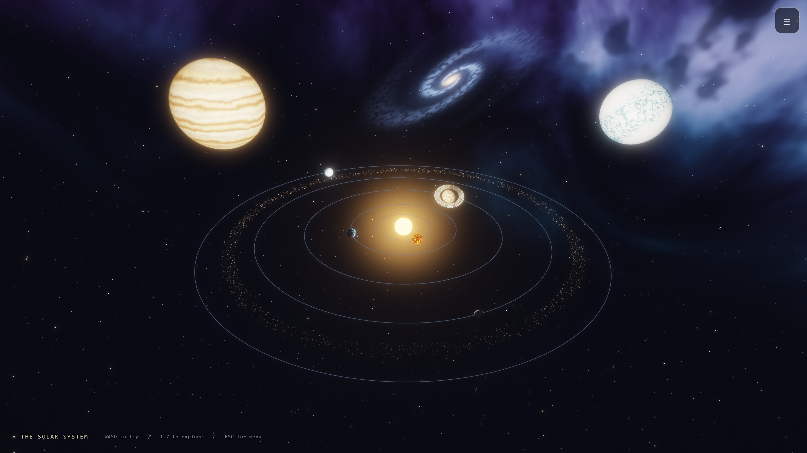
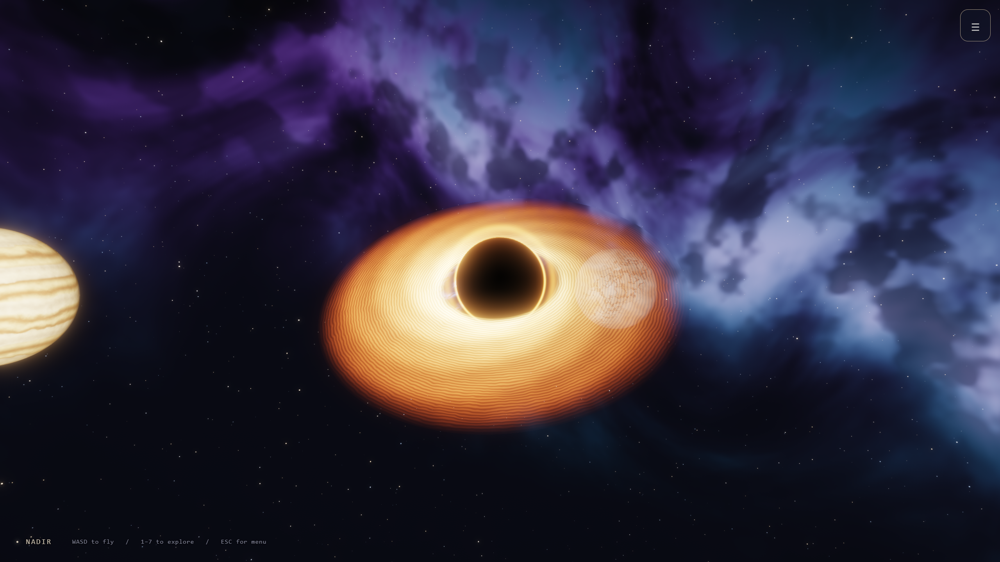
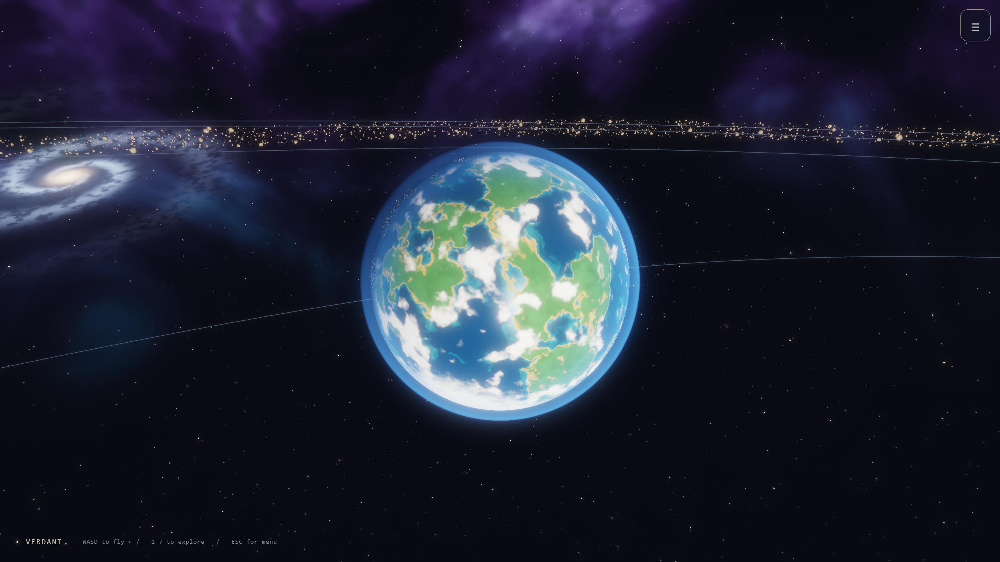

# Abyssal Space

A fully procedural planetary system you can fly through in your browser. Sun-centered worlds, luminous rings, asteroid fields, a black hole, distant giant planets, spiral galaxies and a synthesized onboard soundscape, all in one self-contained HTML file.

No texture images, imported models, audio files, game engines, external fonts or runtime downloads. The documentation screenshots are captures of the live renderer, not assets used by the scene.



## Explore

[Open the live demo on GitHub Pages](https://zeeka32.github.io/abyssal-space/).

Open [`index.html`](index.html) in Chrome or Edge with WebGPU and hardware acceleration enabled, choose a detail level, then press **Start exploration**. Generation, GPU setup, audio sources and simulation begin only after Start. Waiting on the welcome screen does not advance the orbital clock. The file works offline; no server or installation is needed to play.

| Destination | What you will find |
|---|---|
| Aurelia | A banded gas giant with tilted, translucent rings, ring shadows and scattered debris |
| Verdant | Procedural continents, blue oceans, polar ice, moving clouds and lights on the night side |
| Selene | A cratered moon orbiting Aurelia |
| Cinder | A volcanic world with glowing, slowly pulsing lava fissures |
| Veil | A frozen world with fractured ice and a cyan atmosphere |
| Kestrel | A rocky frontier world near the asteroid belt |
| Nadir | A black hole with a dark horizon, animated accretion disk, photon ring and stylized background lensing |

The sun starts at the origin, surrounded by five primary planets at different phases on nearly coplanar circular paths. Subtle orbit guides and the overview show the complete arrangement immediately. Inner worlds have shorter periods. Selene orbits Aurelia; the giant's rings, atmosphere and debris travel with it. Distances and periods are deliberately compressed. This is an artistic system rather than an N-body gravity or general-relativity simulation.

Three enormous planets stand far beyond the local system at fixed positions. Three procedural spiral galaxies fill distant celestial directions. These background objects never orbit the local sun and have no destination buttons.

Destination views follow their world until you start flying. Press its number again to return to its current position. Spherical collision boundaries follow the planets and prevent entering them, the star or the black hole's horizon. Rings and asteroids remain passable.





## Controls

| Action | Control |
|---|---|
| Look | Mouse, with pointer lock |
| Fly | `W` `A` `S` `D` |
| Down / up | `Q` / `E` |
| Boost | Hold `Shift` |
| Overview / Verdant / Selene / Cinder / Veil / Kestrel / Nadir | `1` through `7` |
| Menu | `Esc` |
| Sound on / off | `M` |
| Performance statistics | `H` |

The menu also has destination buttons and **Low**, **Medium**, **High** detail controls. Before Start, changing quality updates the pending choice without generating anything. After launch, changing quality reloads to the welcome screen. Quality and adaptive resolution are remembered independently of the original ocean demo. Once started, the scene keeps rendering behind the pause menu while camera movement pauses.

On touchscreens, hold to move forward, slide to steer, and add a second finger to boost. The corner button opens the menu. Portrait devices rotate the page into landscape. Touch support remains experimental.

## Procedural implementation

- Seeded CPU generators build icosphere meshes, an annular ring mesh and asteroid instances. High detail has 8,300 asteroids and ring fragments; Medium has 4,100; Low has 1,800.
- WGSL functions generate all surface colors and detail directly from 3D coordinates. No UV texture maps are loaded. The starfield stays fixed in celestial directions while nearby objects have parallax.
- Direct WebGPU rendering uses reversed depth, instanced geometry, atmospheric shells, analytic ring shadows, HDR bloom and tone mapping. High and Medium use 4x MSAA; Low uses fewer triangles and noise octaves, and no MSAA.
- Camera state, sort buffers and render descriptors are reused. Adaptive resolution targets approximately 60 fps, with GPU timestamp queries where supported. Device loss retries at a lower quality level.
- Web Audio oscillators generate a reactor hum, pitched ion-drive harmonics, a rising warp-charge tone, harmonic pads and navigation tones after user interaction. Cruise and boost follow flight velocity and input; orbital camera tracking is silent. There are no wind or broadband-noise sources. These are fictional onboard sounds.
- The menu footer links to [this project's GitHub repository](https://github.com/Zeeka32/abyssal-space) and credits [Noniv's Abyssal Garden](https://github.com/Noniv/abyssal-garden).

## Build and edit

Requires Node.js 18 or newer:

```sh
cd source
npm ci
npm run build
```

This rebuilds `index.html` in the repository root. The build reports the uncompressed and gzip sizes. `npm run build:readable` writes an unminified `index.html`; run `npm run build` again before distributing it.

GitHub Pages publishes the root of `main` directly, with `.nojekyll` preserving the static files. To publish source changes, rebuild and commit the updated `index.html`, then push to `main`.

`npm run build:dev` writes a separate, ignored `dev.html`. In that version, `F` flies a 60-second route, and `B` runs the route as a benchmark with fixed resolution and frame/GPU timing statistics. `F`, `B` or a destination shortcut cancels a flight. Development diagnostics never ship in `index.html`.

| File | Purpose |
|---|---|
| [`world.js`](source/src/world.js) | Planet definitions, seeds, ring orientation, asteroid generation, viewpoints and camera route |
| [`shaders.js`](source/src/shaders.js) | Procedural surfaces, starfield, nebulae, atmospheres, rings, lighting and postprocessing |
| [`main.js`](source/src/main.js) | WebGPU resources, renderer, free flight, collisions, input and adaptive resolution |
| [`audio.js`](source/src/audio.js) | Synthesized onboard soundscape |
| [`quality.js`](source/src/quality.js) | Quality selection, saved settings and crash recovery |
| [`start.js`](source/src/start.js) | First-click gate and pre-start quality controls; all generation follows this gate |
| [`math.js`](source/src/math.js) | Seeded randomness, noise, quaternions and mesh helpers |
| [`dev.js`](source/src/dev.js) | Development camera flight, benchmarks and browser diagnostics |
| [`template.html`](source/template.html) | Loading state, observatory menu, controls and flight overlay |

To customize the system, edit `BODIES`, `STAR`, `BLACK_HOLE`, `DISTANT_WORLDS`, `RING_TILT`, `RING_TWIST` and `OVERVIEW` in `world.js`. Each local body defines an orbital radius, starting phase, inclination, physical radius, surface kind, seed, spin and atmosphere. `updateOrbits` evaluates circular positions from absolute simulation time; each orbital plane passes through its parent. The distant worlds are stored separately and remain fixed. Movement speeds are `240 : 65` in `main.js` (boost : cruise).

## Verification

On Windows with Python 3 and Chrome installed:

```sh
cd source
npm run build
npm run build:dev
cd ..
python tools/check_scene.py --screenshots --benchmark
python tools/check_scene.py --quality 1
python tools/check_scene.py --quality 2
```

The standard-library-only checker launches headless Chrome with real WebGPU, exercises controls, cruise/warp audio state and all seven destinations, and checks collisions and the camera path. It verifies zero GPU requests before Start, pre-start quality changes, initial phases around the sun, a shared orbital plane and fixed background worlds. It samples 421 orbital configurations for constant radii and planet separation, checks viewpoint tracking, verifies the footer credit and rename, and opens the minified production file directly from disk. It fails on JavaScript or WebGPU validation errors. Screenshots, browser logs and benchmark reports go to the ignored `.checks/` directory. Default viewport is 2560 x 1440; `--width` and `--height` override it.

Measured results and limits are recorded in [`VERIFICATION.md`](VERIFICATION.md). Headless timing is specific to the test machine; it is not a performance guarantee for other devices. Physical mobile devices are not part of this verification.

## License and origin

[MIT](LICENSE). Adapted from Maksymilian Dendura's Abyssal Garden, retaining its single-file, procedural, direct-WebGPU approach and shared mathematical helpers.
